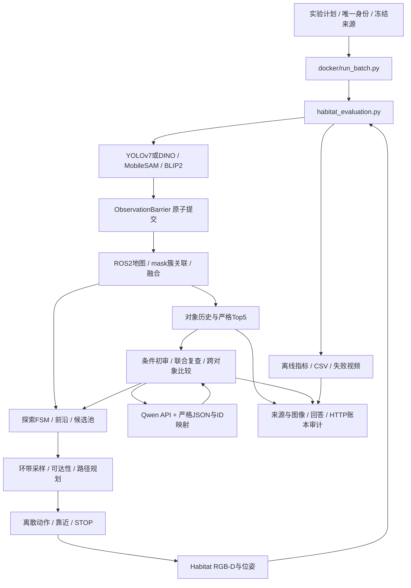

# ApexNav 最终版：创新点、架构与模块维护

本文件是后续开发的主设计索引。2026-11-18用户选定 **Q8-C2-semantic-v2** 为当前最终基准；实际实现由`linked_choice`、`semantic_guard_v2`、`image_order_v1`及三个C2开关组合。默认baseline行为仍保留，不能仅凭运行当前HEAD就认为启用了最终方法。

最终成绩为新三类385/487，保留其他513后混合772/1000（77.20%）。结果来源、局限和配对变化见[实验总结](EXPERIMENT_SUMMARY.zh-CN.md)。历史运行HEAD为`237e292a52c9b41d9a10dfcafa836a2001a84457`；本次整理只调整测试和文档，不改变导航算法，不重跑实验。

## 1. 我们的改进与原项目的边界

这里的“创新点”指**相对本仓库原基线增加的设计**，用于组织后续研究与消融，不声称已证明文献首创。ApexNav原有目标中心语义融合、自适应探索、地图/前沿与路径规划仍是基础；ROS2 Jazzy移植来自社区版本，保留原作者与移植者署名。本项目没有重新训练检测器或Qwen。

### 1.1 带精确对象来源的条件复查闭环

原融合置信度达到资格，或同对象最佳crop检测分数严格大于0.7时，触发Qwen首轮单图检验。输出分为confirmed / rejected / uncertain。只有不确定且满足调度约束时才申请补充观测，避免所有候选都绕行复查；有可达已确认替代目标时可以延后观测，400步后不再发起观测绕行。

复查绑定mapper实际mask簇，而不是靠图像相似度猜对象。每候选最多两次完整类别调用：首轮单图、观测后一次联合复核。原始回答、实际分数和最终使用的决定分别保留，比较选择不会把uncertain改写成confirmed。

**实现**：`vlm/fused_review.py`、`vlm/annular_review.py`、`vlm/choice_review.py`，C++探索FSM。**验证边界**：闭环与调用上限有回归/审计，尚无该模块单独关闭的全1000消融。

### 1.2 严格Top5对象证据与环带主动观测

每个对象仅保留严格排序的Top5历史crop。首先按检测分数降序，再以完整性、mask像素数、新旧观测及原mask序号作稳定排序。首审只用最高分单图；观测后按当时Top5联合1–5图。新拍摄图如果未进入Top5就不强行加入，避免为证明补拍有效而更换证据规则。

RGB-D观测估计对象空间包围范围，并结合相机高度、固定pitch和FOV计算拍摄距离；规划器在环带/短弧上检查空闲、可见、可达和朝向，正常观测可取2–3个点。几何来自已观测深度，不读取Habitat真实目标位置。

**实现**：`vlm/framing_review.py`、`vlm/annular_review.py`、C++ `active_view.h`。**验证边界**：有几何正负例、回执/像素审计；高度观测历史实验说明额外动作可能降低SPL，不能假定多视角必然更好。

### 1.3 基于最佳crop拍摄位姿的受限备用观测

主观测几何或路径在执行任何观测动作前不可用时，允许一次备用方案：使用最佳crop真实拍摄位姿到对象中心的距离作为半径，环带为`[max(0.6,r−0.25), min(4.5,r+0.25)]`米、扇区±30°。可以退化为一个合格的朝向对象采样点；仍必须通过几何与安全检查。

备用方案共用原观测预算、起始步数和两次类别调用上限；已经执行观测动作后不再重开另一圈，也不任意缩小半径来“凑”可行解。

**实现**：`vlm/crop_pose_review.py`、C++ `active_view.h`。**开关**：`crop_pose_fallback`、`crop_pose_single_view`。

### 1.4 类别确认与跨对象相对比较分开

类别检验回答“这个对象是否符合目标”，候选比较回答“当前候选里先去哪个”。比较每个对象的一张最佳crop；每组最多5个对象，较大候选池按组选择后继续比较组内胜者，直到选出一个。这是分组淘汰选择，不是多数投票，也不是同一对象的多视角联合检验。

400步前比较至少两个可达已确认候选；400步后，存在任何已确认候选时不走晚期未确认比较，否则比较可达非拒绝候选。无前沿时使用已复查、可达、非拒绝池，若有已确认候选则优先该子集；只有一个候选时无需比较API。比较仍强制选一，不改变类别状态和分数；这是潜在误报来源之一。

**实现**：`vlm/choice_review.py`、C++ `candidate_choice.h`、FSM `maybeCompareCandidates`。**开关**：`linked_choice`、`choice_no_frontier`。旧Q5加权公式不是最终所有阶段统一排序规则，最终环带排序见`src/planner/plan_env/include/plan_env/review_rank.h`。

### 1.5 任务语义提示词与无歧义图片编号

`semantic_guard_v2`在v1基础上，分别作用于**类别检验**（首轮单图和观测后联合图）以及**候选选择**：

| 类别 | 类别检验 | 候选选择 |
| --- | --- | --- |
| bed | 普通床含单人床可凭辨识力足够的局部确认；不把扶手椅/躺椅解释成小床 | 优先床结构证据充分者，局部裁剪不自动淘汰 |
| couch | 清楚的多座沙发可确认；独立单座软包/扶手椅/单座沙发保持uncertain候选 | 优先清楚多座结构，降低独立单座优先级，仍必须选一 |
| tv | 要有显示硬件证据；黑屏优先，但明确播放画面的电视仍可确认；画作/镜子/黑矩形歧义保持uncertain | 先看电视硬件证据，同等证据下偏好黑屏，不能只凭黑色选电视 |

chair/plant/toilet文本逐字继承v1。实际英文文本、JSON输出要求及例外以`vlm/qwen_review.py::build_prompt`为准，表格是设计摘要。

`image_order_v1`让Qwen只返回1～N图片序号，严格校验后按有序映射恢复mapper真实ID；保留`raw_answer`、映射后的`answer`、`api_candidate_ids`、`candidate_id_map`与prompt/图像哈希。不从reason猜答案，不宽松接受越界编号。该设计解决了已复现的“图片5/真实ID7”混淆，属于接口可靠性改进。

**验证边界**：新487总体比v1多4成功，但床+7、沙发持平、电视−3；不能宣称三个类别均改善。编号接口有离线及真实续跑验证，整体487仍包含旧版编号协议差异。

### 1.6 观测同步与可审计实验体系（工程贡献）

Python执行动作后，当前深度/位姿/检测通过单一观测服务提交，必须收到匹配的应用回执和mask簇关联，才通知规划器继续。结合episode token、observation ID、候选revision和比较request ID拒绝迟到/跨回合消息。

每次输入来源、回答、HTTP尝试、账本、源码/配置/构建/权重指纹均留证；完整失败视频按steps+1保存并独立全帧解码，成功临时视频删除。网络恢复有次数和异常类型边界；响应错误、审计错误、初始化错误不能当作普通网络错误无限重试。

这保证结果可追溯和不同版本可比较，属于必要工程基础，不应和算法收益混为一项。

## 2. 整体架构



Habitat目标真值只用于评测指标与离线检查，不进入在线Qwen请求、候选选择或新增观测规划。四个本地模型服务通过HTTP使用；云端Qwen补充目标复查和比较，不替代所有本地感知。

| 层 | 主要位置 | 输入 → 输出 / 职责 |
| --- | --- | --- |
| 运行入口 | `docker/apexnav`、`docker/run_batch.py` | 命令/配置 → 独立实验目录、精确来源、单份评测 |
| 仿真主循环 | `habitat_evaluation.py` | 离散动作 → RGB-D、位姿、调用感知/ROS、记录结果 |
| 感知 | `vlm/utils/get_object_utils.py`、`get_itm_message.py` | 检测与分割、BLIP2 ITM → mask/置信度/语义信息 |
| 模型服务 | `vlm/server_wrapper.py`及各模型服务脚本 | YOLO 12184、DINO 12181、SAM 12183、BLIP2 12182；健康/HTTP调用 |
| Python↔ROS | `habitat2ros/habitat_publisher.py`、`observation_barrier.py` | 图像/位姿 → 应用回执、原mask到候选ID关联 |
| 地图 | `src/planner/plan_env/` | 已观测深度、检测 → 占据/前沿/对象融合与来源关联 |
| 决策 | `src/planner/exploration_manager/` | 地图、复查状态 → 探索/观测/比较/靠近/停止 |
| 路径 | `src/planner/path_searching/`及LKH依赖 | 目标/地图 → 可达路径与访问顺序 |
| 复查器 | `vlm/*_review.py` | 原始crop与来源 → 真实回答、分数、观测请求、比较选择 |
| Qwen接口 | `vlm/qwen_review.py` | prompt/有序图片 → 严格JSON、局部/真实ID映射、费用证据 |
| 结果 | `basic_utils/record_episode/experiment.py` | 唯一身份与事件 → CSV、视频、provenance和恢复边界 |
| 离线验收 | `docker/audit_annular.py`及各冻结批次审计器 | 原件 → 像素/几何/调用/费用/视频检查，不修改在线分数 |

`llm/answers/`是已有语义先验缓存；最终配置不需要另启在线Ollama。ROS2连续速度控制/轨迹模块和`real_world_test_example/`示例不属于本次离散评测主链，保留供未来Tracer Mini适配；目前没有实机运行结果。

## 3. 一回合实际流程

1. **身份与来源**：从固定episode计划取身份，CLI零基索引与全局编号对应；记录seed、500步、prompt策略、源码/构建/模型。加载四模型并检查资源。
2. **感知与同步**：采样RGB-D/位姿，检测、分割和ITM；保留绘制框之前的原始RGB。提交当前观测，等待mapper应用回执及每个原mask的候选归属。
3. **维护对象证据**：按真实候选ID保存crop、原mask、深度/位姿、边界、检测分数等来源；按严格排序更新Top5。
4. **初审**：融合资格或best crop>0.7触发最高分单图Qwen检验。质量不足保持uncertain；明确拒绝不因高融合分数改为确认；plant继续使用既有0.60有效确认规则，原始回答仍保存。
5. **按需观测**：不确定候选且调度允许时申请朝向对象的环带观测。主路线初始不可用时按开关尝试一次crop-pose备用；400步后不再新绕行。
6. **联合复核**：观测结束后，对当前Top5的1～5图进行第二次、也是该候选最后一次完整类别调用；不强求新图入选。
7. **比较或继续探索**：依阶段构造池；每个对象一张最佳图进行分组比较。结果只影响选择，不提升状态或篡改分数。无候选则沿既有前沿探索逻辑推进。
8. **靠近/结束/审计**：保持原靠近、STOP和碰撞逻辑。完整结果唯一计数；失败保留完整视频，成功删除临时视频；保存每个调用和来源，批次结束独立验收后才汇总。

两个容易混淆的接口：

| 请求 | 图片含义 | 回答含义 |
| --- | --- | --- |
| 类别复查 | 同一对象：首轮1图，第二轮1～5图 | decision、quality、target_confidence等 |
| 候选比较 | 不同对象：每对象1张最佳图，每组≤5图 | 选中的图片序号，再映射真实candidate ID |

## 4. 关键协议与不可破坏的约束

消息定义位于`src/planner/plan_env/msg/`和`srv/`，字段以实际定义为准。

- `NavigationObservation` / `ApplyObservation`：token、observation_id、深度、相机/机器人位姿、检测和ITM；回执必须匹配本回合本步。不能超时后假定应用成功再继续规划。
- `DetectionAssociation`：候选ID数组逐项对应**原始mask顺序**；0表示未关联。不得排序mask后再套用旧回执。
- `ReviewEvidence` / `ScoredReviewResult`：候选身份、revision、证据/观测资格以及实际复查结果与分数。旧候选消息不能更新新对象。
- `CandidateComparison`：token、observation、request、精确有序候选池、选择结果和phase reason；请求与回执一致才采纳。
- 规划器内部ID从0开始；ROS候选ID使用+1且0保留；Qwen `image_order_v1`又是单次请求的1～N序号。三种编号不能直接混用。
- 动作顺序：`ACTION_EXEC → env.step → 感知 → ApplyObservation与关联回执 → ACTION_FINISH → 下一次规划`。
- 类别调用上限不等于总HTTP上限：单候选最多两次完整类别检验；跨候选比较另计，网络尝试逐次入账。不得靠改日志清次数。
- Qwen异常回答必须停止并留证，不能从reason补字段或把异常当拒绝；预算/证书/HTTP/来源审计错误不能套用transport重试。

## 5. 当前配置与版本依赖

| 项目 | 最终设置 |
| --- | --- |
| method / backend / profile | `selected_review` / `qwen` / `linked_choice` |
| prompt / comparison ID | `semantic_guard_v2` / `image_order_v1` |
| 同步 / seed / 步数 | `step_sync=true` / 100 / 500 |
| 观测阶段边界 | `uncertain_after_steps=400` |
| C2开关 | crop-pose-fallback、crop-pose-single-view、choice-no-frontier均开 |
| frontier-look | 关闭 |
| 视频 | 只保留完整失败 |

默认CLI仍是baseline/legacy，属于兼容能力；维护时使用显式profile，不直接改变默认值来暗中“升级”旧实验。

仅检查命令生成的例子（容器内、项目根目录；`--dry-run`不启动、不创建实验）：

```bash
/opt/apexnav_venv/bin/python docker/run_batch.py hm3dv2 \
  --episodes 1 --episode-index 0 --seed 100 --max-steps 500 \
  --method selected_review --review-backend qwen --review-profile linked_choice \
  --step-sync --uncertain-after-steps 400 \
  --qwen-prompt-policy semantic_guard_v2 --qwen-choice-id-policy image_order_v1 \
  --crop-pose-fallback --crop-pose-single-view --choice-no-frontier --no-frontier-look \
  --qwen-budget-ledger experiment_notes/qwen-paired50-20261110/budget.json \
  --failure-videos --dry-run
```

新实验必须另定身份集合、独立输出与预算授权；不能移除dry-run后把单例当完整487重测。既有账本不能重置，key只在`config/vlm.env`，不能输出或提交。

最终复查器依赖链（类继承，不是动态插件系统）：

```text
SelectedTargetReviewer   active_view.py
  └─ LinkedTargetReviewer   linked_review.py
     └─ FusedTargetReviewer   fused_review.py
        └─ ConfidenceTargetReviewer   confidence_review.py
           └─ FramingTargetReviewer   framing_review.py
              └─ AnnularTargetReviewer   annular_review.py
                 └─ ChoiceTargetReviewer   choice_review.py
                    └─ CropPoseTargetReviewer   crop_pose_review.py  ← 最终入口
```

这些父类仍提供最终运行方法，名字带旧阶段不代表无用。`EarlyTargetReviewer`是保留的独立消融分支。删除模块前必须沿导入、继承、profile派发、配置和审计一起核对，不能只看当前profile名字。

## 6. 精简后的项目分工

```text
ApexNav/
├── habitat_evaluation.py / habitat_vel_control.py  仿真与控制入口
├── habitat2ros/              观测与ROS适配
├── vlm/                     感知服务、复查状态机与Qwen接口
├── src/planner/             C++地图、探索决策和路径规划
├── config/                  配置；vlm.env为本机秘密，不提交
├── basic_utils/ / llm/      记录工具与语义先验
├── docker/                  环境、批处理、审计和运维脚本
├── tests/                   单一测试入口；测试不再散在vlm/docker
│   ├── unit/                Python离线回归
│   ├── cpp/                 C++纯逻辑断言
│   ├── integration/         ROS真实节点/消息与Habitat兼容检查
│   └── fixtures/            旧提示词48组兼容哈希
├── docs/                    本设计、结果总结、历史实验记录
├── experiment_notes/        本地冻结计划/来源/账本/验收证据
└── outputs/                 本地构建、运行输出、图片与失败视频
```

第三方依赖、模型权重、数据集及既有构建按环境实际位置保留。本次将31个分散测试文件整理为24个，合并Qwen响应、提示词、离线审计、规划器启动与观测几何的同类测试；208个显式Python测试方法保留，移除旧位置和重复加载。具体入口与覆盖见[测试说明](../tests/README.md)。历史报告内的旧测试路径保持原始记录，查看旧提交/快照可恢复对应结构。

不移动原始实验结果或删除事故/partial现场，不在收尾时重构运行状态机。原模块和旧profile留作复现与消融基础；这次结构精简聚焦测试目录与文档导航。

## 7. 后续如何增加、替换或关闭模块

| 想改什么 | 首先修改/检查 | 必须同步检查 |
| --- | --- | --- |
| 类别语义或输出约束 | `vlm/qwen_review.py::build_prompt`、严格解析器 | 新policy名；保留旧prompt哈希；单图/联合/选择三路径、非法响应与ID测试 |
| crop选择/证据融合 | `fused_review.py`、`annular_review.py` | 原mask关联、排序稳定性、像素重建、源图顺序及离线审计 |
| 观测距离/采样路线 | `framing_review.py`、`crop_pose_review.py`、C++ `active_view.h`及FSM | 半径/朝向/可见/可达、调用/动作预算；C++重新构建独立overlay |
| 触发与候选排序/比较 | `choice_review.py`、C++ `candidate_choice.h`、`plan_env/review_rank.h`、FSM | 400步边界、已确认池、无前沿池、缓存/回执；不篡改类别状态 |
| 消息或新状态字段 | plan_env消息/服务、barrier、发布订阅两端 | 两端同版构建、token/step顺序、拒绝迟到消息的真实ROS集成测试 |
| 模型替换 | 感知客户端/服务、配置与权重指纹 | 独立实验变量；接口形状、mask顺序、资源门槛；不可冒称同版 |
| 调度、恢复、结果合并 | `docker/run_batch.py`、`network_recovery.py`、批次控制 | 唯一完成attempt、保留前缀、费用不重置、同身份比较、异常停查 |
| 迁移Tracer Mini | 位姿/图像发布与动作适配层 | 硬件接口、急停、限速与显式实机授权；先做离线/仿真接口检查 |

开发顺序：

1. 明确新模块的输入/输出、与现有状态机的关系及单一实验变量；先列同身份对照，禁止在线接入真值。
2. 增加显式开关或新profile/policy，默认保持旧行为；在`config/`、`docker/run_batch.py::evaluation_command`和`habitat_evaluation.py`派发处贯通，涉及C++时同步launch参数。
3. 先运行受影响单元/C++测试，消息变化再跑真实ROS集成测试；新增有意义的边界和故障注入，避免只重复实现细节。
4. 在没有评测运行时修改/构建；新建独立输出与来源冻结。先做CLI/Hydra配置核验，再按用户授权执行导航。不同版本不复用旧冻结控制目录。
5. 同身份汇总成功/失败、SR/SPL/SoftSPL、FP、费用与配对增减；新结果全部纳入，不择优保留。最后独立审计并更新本设计/总结。

关闭模块优先通过已有开关或独立profile完成消融；删除代码需先解除依赖并保留历史Git/快照复现路径。新增功能不能直接混入最终版已验收成绩。

## 8. 已知边界与待处理事项

- 电视类别仍是明显短板，误报可能涉及语义、证据裁剪或导航/停止；需按API原图、回答、轨迹逐例判别，不能只凭FP标签归因。
- 强制候选选择在全部uncertain时仍需选一，后续若改为允许拒选，应作为独立变量重测。
- 多视角动作有成本；需要完整同集合消融判断Top5、环带与比较各自贡献。
- 当前复查器继承层级较深；以后若拆为组合式模块，应先冻结行为合同并证明同配置等价，再改变实验版本。本次不作该运行重构。
- 历史±π审计修正位于批次冻结的离线helper，按圆周角比较且XY/yaw容限仍为6e−5；根目录`docker/audit_annular.py`保持原运行来源。复验历史数据必须使用对应已验收的批次审计器，不能用当前通用脚本替代；若统一审计实现，应另作代码变更与兼容验证。
- PyTorch初始化时钟断言的系统根因仍未确定；一次恢复成功不代表已修复。没有通用自动初始化或响应异常重试。
- 最终版实验已结束；旧`launch.sh`、started和恢复目录均为归档，不再启动。新的工作从本设计、[实验总结](EXPERIMENT_SUMMARY.zh-CN.md)和真实进程状态开始，不能把历史交接中的“继续运行”当成新授权。
